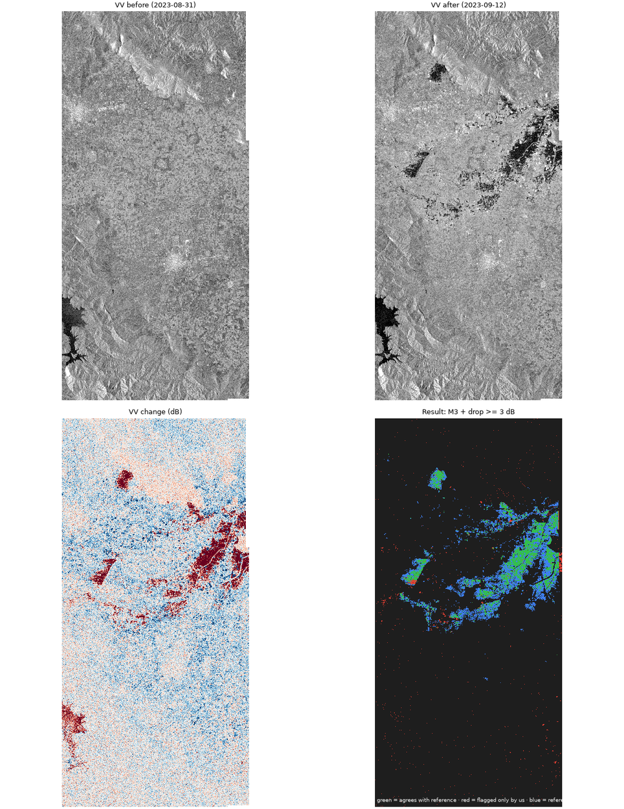
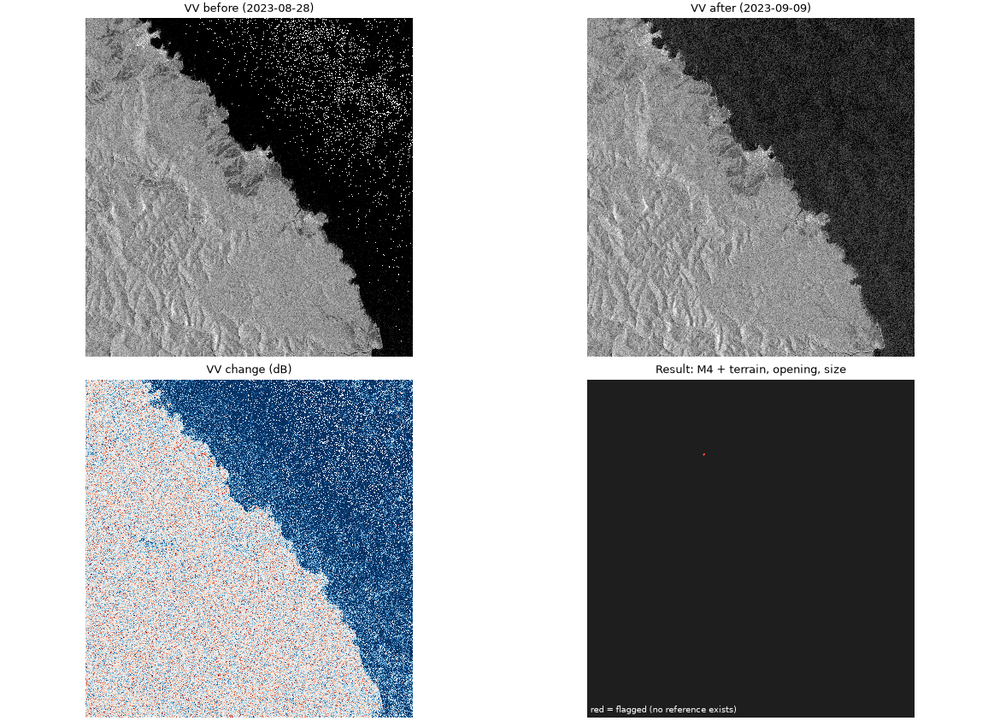

# Spike: flood detection from Sentinel-1 on CDSE (archived events, September 2023)

**Question.** Can a simple, deterministic Sentinel-1 change detector, run through the Copernicus Data
Space Ecosystem (CDSE) APIs, produce flood findings good enough to build an STOZHER layer around
(areas of interest for review, road segments affected, an LLM that explains them)?

**Verdict.** Partly, and only a narrow version.

- On a **large, slow flood on flat farmland** (Thessaly, Greece) it is **reliable but incomplete**: about
  **90% of what it flags is flooded, but it finds only 33-44% of the flooded area** (F1 0.49-0.59). It
  finds the open-water cores and misses a large flooded zone around them that leaves no radar signature.
- On a **flash flood in steep, forested valleys** (Tsarevo, Bulgaria) it finds **nothing**. The
  first Sentinel-1 pass was 4 days after the peak, and Copernicus's own rapid-mapping service also
  could not produce a delineation.
- So build **"possible open-water flooding near a route or site, as of scene date X, extent is a
  minimum"**, not "flood map" and not "this road is passable". Never read "not detected" as "not flooded".

One validation event and one transfer event: treat the numbers as a strong indication, not a benchmark.

## Events and references

| | Thessaly plain (EMSR692, AOI Karditsa) | Tsarevo, Bulgaria (EMSR693) |
|---|---|---|
| Terrain | flat farmland, about 100 m | steep forested coast (Strandzha), rivers a few tens of m wide |
| Event | storm Daniel, 5-7 Sep 2023 | flash flood, evening of 5 Sep 2023 |
| Sentinel-1 | orbit 175, ascending: 31 Aug (before), 12 Sep 16:32 UTC (after) | orbit 131, ascending: 28 Aug (before), 9 Sep 16:08 UTC (after) |
| Reference | Copernicus EMS delineation from SPOT-6/7 of 12 Sep 08:54 UTC (7.5 h earlier), "Flooded area" polygons: 96.8 km2 inside 950.6 km2 analysed | **none**: the EMS product is marked "Not produced because of remote sensing limitations", although a COSMO-SkyMed image of 8 Sep exists |

Sentinel-1 timing matters. Over Tsarevo the passes around the event were 4 Sep (orbit 58), then
**9 Sep** (orbit 131), 15 Sep, 16 Sep. Nothing between the peak and 9 Sep. The same-geometry pair is
orbit 131; the 4 Sep and 16 Sep pair would be 12 days apart.

## Method (all deterministic, one rule per step)

CDSE does the heavy processing through **openEO** (`spikes/eo_flood/cdse_composites.py`): Sentinel-1
GRD VV/VH, `sar_backscatter` (sigma0, noise removal, Copernicus 30 m DEM), one same-orbit acquisition
before and one after (chosen by exact day), mean of the frames of a pass, dB, and the DEM aligned to
the same grid. One batch job returns a 5-band GeoTIFF. Classification and scoring run locally
(`flood.py`, `run_event.py`):

| Variant | Rule added |
|---|---|
| M1 | post-event VV below a water threshold |
| M2 | and not water in the pre scene (permanent water removed) |
| M3 | and VV dropped by at least 3 dB |
| M4 | and slope below 5 degrees, 3x3 opening, objects of at least 0.5 ha |
| M5 | and VH also below its threshold |

Thresholds come from Otsu on the post scene alone, clipped to a sane range; the reference is never
used to set them. (Karditsa: VV -12.0 dB, which is the upper clip; Tsarevo: -15.8 dB.) Median 3x3
despeckling. Scores are pixel counts inside the reference's analysed area. Choosing the best variant
by F1 on the reference is optimistic.

## Results: Thessaly



*Green: agrees with the reference. Red: flagged only by us. Blue: flooded in the reference, missed by us.*

| Variant | Flagged | Precision | Recall | F1 | IoU |
|---|---|---|---|---|---|
| M1 post-event water | 310.6 km2 | 0.30 | 0.58 | 0.40 | 0.25 |
| M2 + new water only | 91.7 | 0.60 | 0.42 | 0.49 | 0.32 |
| **M3 + drop >= 3 dB** | 44.5 | **0.88** | 0.38 | **0.53** | 0.36 |
| M4 + terrain, opening, size | 35.2 | 0.93 | 0.33 | 0.49 | 0.32 |
| M5 + VH confirms | 34.3 | 0.93 | 0.32 | 0.48 | 0.32 |

- Each rule buys precision (0.30 to 0.93) and costs recall (0.58 to 0.32). The reference is 96.8 km2.
- **Size.** Of the reference area in small objects (under 0.5 km2) we recover 15%, in medium ones
  41%, in the one large object (40 km2) 49%.
- **Threshold.** F1 of M4 vs the water threshold: -22 dB 0.13, -20 0.32, -18 0.44, -16 0.52, -14 0.54,
  -12 0.49. Flat between -16 and -12; collapses below -20.
- **Roads.** The reference puts 44.6 km of the 2,968 km of OpenStreetMap roads in flooded polygons;
  we flag 25.0 km (56%). On road pixels precision is 0.47 and recall 0.26. Village streets are the
  weak spot (reference 12.0 km, us 1.8 km): buildings defeat radar. Road length is approximate
  (rasterised at 20 m).

### Why the recall is low (checked, not guessed)

`separability.py` compares the reference flood with other flat land, one feature at a time:

| Feature | AUC (0.5 none, 1.0 perfect) |
|---|---|
| post VH | 0.77 |
| VV change (drop) | 0.79 |
| **VH change (drop)** | **0.81** |
| VV increase | 0.21 |

| Pixels | Median post VV | Median VV change |
|---|---|---|
| flooded, **caught** (101,580) | -19.9 dB | -9.3 dB |
| flooded, **missed** (140,287) | -9.7 dB | **0.0 dB** |
| not flooded | -9.3 dB | +1.2 dB |

The missed flooded pixels are **radar-invisible**: no change, and as bright as dry land. Relaxing the
drop to 1 dB (at a -14 dB water threshold, flat land only) lifts recall only to 0.44 (F1 0.59). So the limit is the signal, not the threshold. A
hypothesis from the picture, flooded vegetation appearing brighter, was tested and **not supported**
(`exploratory_vegetation.py`: backscatter increase within 500 m of open water adds 4 km2 correct and
14 km2 wrong; F1 unchanged at 0.485). Plausible causes, untested: shallow or turbid flooding and wet
soil that the optical reference counts but radar does not separate; water receding between the two
passes; reference polygons including areas not flooded at the radar's time.

## Results: Tsarevo



Of 480.7 km2 analysed: M2 flags 2.0 km2 and M3 0.8 km2, and M4 0.0 km2 (one speck); no road is
flagged (196 km of roads). The picture shows why: the land is dense forest with identical texture
before and after; the only large change is the sea surface (wind roughness). "Post-event water" of 194 km2
(M1) is the Black Sea. A flash flood in narrow valleys under canopy, 4 days earlier, leaves no
10 m radar footprint. This agrees with the EMS finding that a delineation was not possible.

## What it means for STOZHER

1. **Scope.** An EO finding is an *area of interest for review*: "Sentinel-1 shows N km2 of new open
   water between 31 Aug and 12 Sep, crossing km X-Y of route R". It always carries scene dates and a
   `data_age_s`, and states **"minimum extent; absence of a finding proves nothing"**. This matches the
   spec and CLAUDE.md rule 5.
2. **Where it earns its keep:** large, slow floods on open, flat land; confirming that flooding exists
   and locating its cores; watching roads and sites near big rivers, plains and lakes. **Not** flash
   floods in valleys, forests, towns, or anything needing "now".
3. **Latency.** Revisit alone was 4 days at Tsarevo; add processing. An EO layer is a slow layer
   beside the witness network, never an alert source.
4. **LLM.** Keep it as explainer (spec section on the assistant). It would receive the structured
   finding and the validation facts below, and may quote them; it must not estimate extent, infer
   causes, or say a road is passable. A deterministic template already produces the text it would polish:

   > Sentinel-1 (orbit 175) shows 44 km2 of new open water in the analysed area between 31 Aug and
   > 12 Sep 2023 (the largest patch 9.5 km2, mean VV drop 11 dB). It crosses about 0.4 km of motorway
   > and 10 km of tertiary roads. On one validated event this method flagged areas correctly about 9
   > times in 10 but found only about 40% of the flooded area, so this is a minimum extent for human review.

   (Numbers are from this spike's real output; the sentence is a template, not model text.)
5. **Build vs reuse.** The Copernicus EMS Global Flood Monitoring product is an ensemble of several
   algorithms and likely beats this baseline. Before building more, check whether its flood extents can
   be read through CDSE; otherwise improve with Sentinel-2 water indices (cloud-masked) as a second
   source and coherence-based methods for flooded vegetation. Not attempted here.
6. **Data shape.** `findings.geojson` (331 polygons of at least 1 ha for Thessaly: kind, sensor, method,
   scene dates, orbit, area, mean drop) maps directly onto the `eo_findings` table of the specification.

## CDSE notes

- **Cost.** Thessaly job: 381 s, 67 megapixels input, **6 credits**, 79 MB result. Tsarevo: 152 s, 21
  megapixels, **4 credits**, 102 MB. 10 credits in total; the monthly allowance was not checked.
- **Sign-in.** Device-code flow with your own CDSE account; the refresh token is saved in the user
  config directory so later runs are silent. Unattended jobs need an OAuth client in `infra/.env`.
- **Backscatter.** `sar_backscatter` offers sigma0 only (no gamma0). Same-orbit pairs were selected by
  acquisition day; the catalogue lists relative orbit but filtering on it was not needed.
- **Catalogue.** CDSE had the 31 Aug orbit-175 pass (12 days before the event); the other archive tried
  first (Microsoft Planetary Computer RTC) did not, and was dropped.
- **Downloads can break.** One result download died 5 MB short; the job result stays on the server, so
  `cdse_download.py <event> <job id>` re-fetches it without recomputing or spending credits.
- **Public servers.** OpenStreetMap roads came from the public Overpass API (retries, descriptive
  User-Agent); it timed out once.

## Limits of this spike

One validation event; reference from an optical image 7.5 h earlier, itself semi-automatic; 20 m
resolution; baseline is a dry-summer scene; pixel (not object) scoring; variant choice by F1 on the
reference; no calibration or uncertainty estimate; roads approximate; sea and permanent water handled
only through the pre scene.

## Reproduce

```
uv run spikes/eo_flood/cdse_composites.py karditsa   # sign in once, then CDSE builds and returns the composite
uv run spikes/eo_flood/run_event.py karditsa         # classify, score, roads, figures, findings (data/spike/eo-flood/)
uv run spikes/eo_flood/separability.py               # why recall is low
uv run spikes/eo_flood/exploratory_vegetation.py     # the flooded-vegetation test
uv run spikes/eo_flood/cdse_composites.py tsarevo && uv run spikes/eo_flood/run_event.py tsarevo
```

Reference data: Copernicus EMS rapid-mapping products (EMSR692 AOI 05, monitoring 2), downloaded from its
public API into `data/spike/eo-flood/ems/` (git-ignored). Scripts carry their own dependencies
(inline script metadata) and do not touch the platform environment.

*Contains modified Copernicus Sentinel data (2023), processed in the Copernicus Data Space Ecosystem.
Reference extents: Copernicus Emergency Management Service. Roads: (c) OpenStreetMap contributors (ODbL).*
